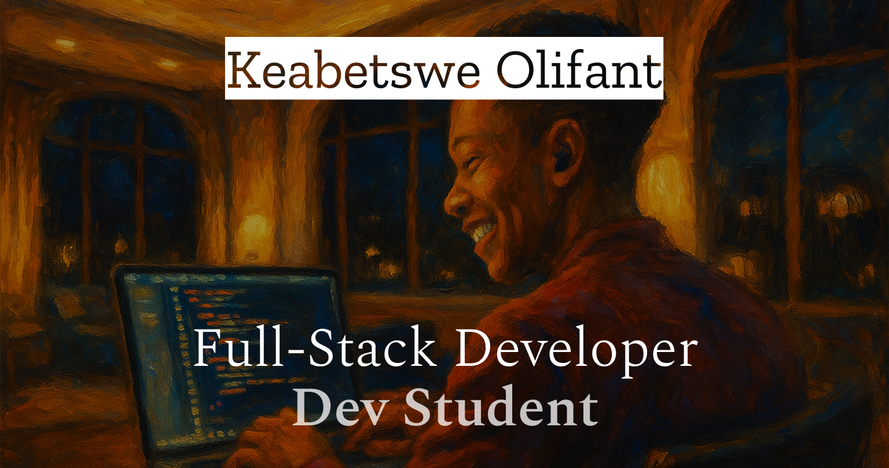
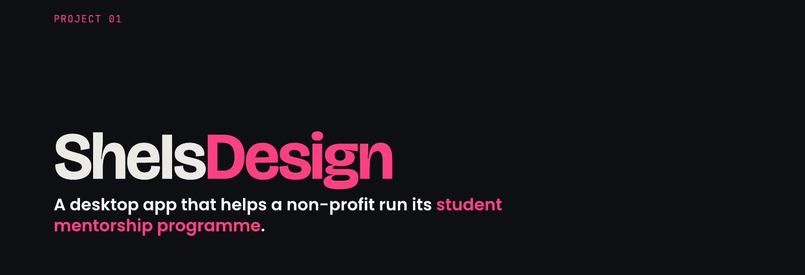
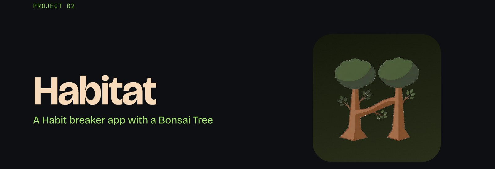
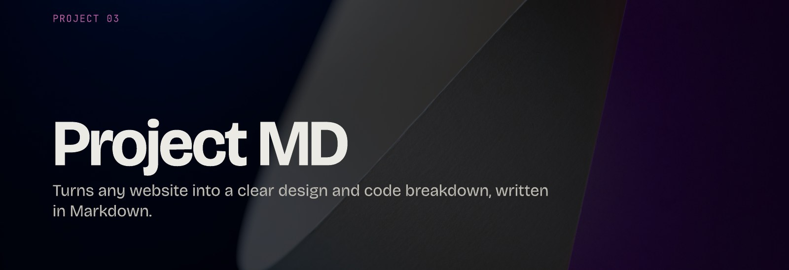

  

 

    

    

----

## 👋 Hi, I'm Keabetswe Olifant

I'm a fullstack developer based in Pretoria, South Africa, studying Creative Technologies (Interactive Development) at Open Window. I focus on full-stack development, game dev and creative computing, and I'm working towards software and systems engineering.

- 🔭 Currently building **Project MD**, an AI tool that turns any website into a design and code breakdown
- 💼 Open to junior developer roles and freelance work in software engineering and fullstack development
- 💬 Ask me about React, C# / .NET backends or testing with xUnit
- ♟️ One game of chess a day keeps the bad code away

 

# ✦ Featured Projects ✦

## SheIsDesign

A desktop app that helps the SheIsDesign non-profit run its mentorship programme for female creative university students, plus the mentors and sponsors who support them. Before this, the NGO had no platform at all. Now events, competitions, judging, a gallery and donations all live in one app.

**My role:** Backend developer, database and testing (team project)

- Built the **C# / ASP.NET controllers and DTOs** and tested every endpoint in Swagger
- Wrote **backend unit tests with xUnit** and measured code coverage
- Set up a **Cloudinary** service as the image CDN for gallery submissions
- Managed the **PostgreSQL** database hosted on Aiven
- Wrote frontend helper functions that made calling the API from React components simpler and more efficient

 

## Habitat

A calm habit-breaking companion for mobile. You pick a habit to break, swipe through a short daily reflection, journal honestly about triggers and relapses, and watch your streak grow a virtual bonsai. The core loop is built on research showing that journaling and awareness are the most effective ways to break a habit.

**My role:** Sole developer

- **Card swiping** for daily check-ins and reflection
- **Journaling** with relapse and trigger logging
- **Streak counter and bonsai** that grows as your streak does
- Designed from scratch to work in **landscape**, with a side navigation rail
- **Firebase** as backend-as-a-service for auth and Firestore data

 

## Project MD

Ever been inspired by a website but had no idea where to start? Project MD answers the questions developers and designers ask about their favourite sites: what design system is this, and how were these animations made? Paste a URL and it scrapes the site, analyses it with an LLM and hands you a clear breakdown as a Markdown document.

**My role:** Solo developer

- **Paste any URL** (after creating an account) and Playwright scans the site
- **Design breakdown:** Groq analyses the CSS, colours and typography, with previews from the Playwright scans
- **Animation breakdown:** Groq's vision model describes the site's animations in code
- **Markdown export** for developers inheriting or rebuilding a site
- Structured the codebase into frontend functions, backend services, an API client, controllers, migrations and data folders

 

### ✦ Earlier Projects (2025) ✦

<table>
  <tr>
    <td width="33%" valign="top">
      
       <b><a href="https://github.com/KBOlifant/formative-one-AnalysisOne">Analysis One</a></b>
       F1 tracker for comparing teams with charts and historical timelines.
    </td>
    <td width="33%" valign="top">
      
       <b><a href="https://github.com/GabyNor05/Psychpix">Psychedelic Pixels</a></b>
       E-commerce platform for surreal, unconventional artwork (team project).
    </td>
    <td width="33%" valign="top">
      
       <b><a href="https://github.com/KBOlifant/CourtClinic">Court Clinic</a></b> · <a href="https://courtclinic.online">Live</a>
       Marketplace where people post legal cases and lawyers bid on them.
    </td>
  </tr>
</table>

 

# ✦ Skills & Tech Stack ✦

**Languages** 

**Frontend & Mobile** 

**Backend & Data** 

**Testing & Tools** 

 

### ✦ My Stats ✦

  
  

  

- - - -

### ✦ Get in Touch ✦

  
  

